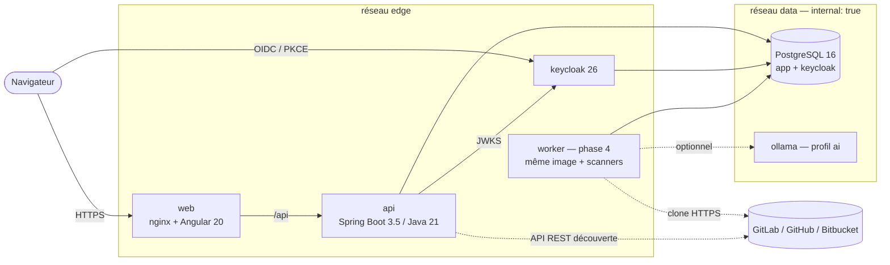
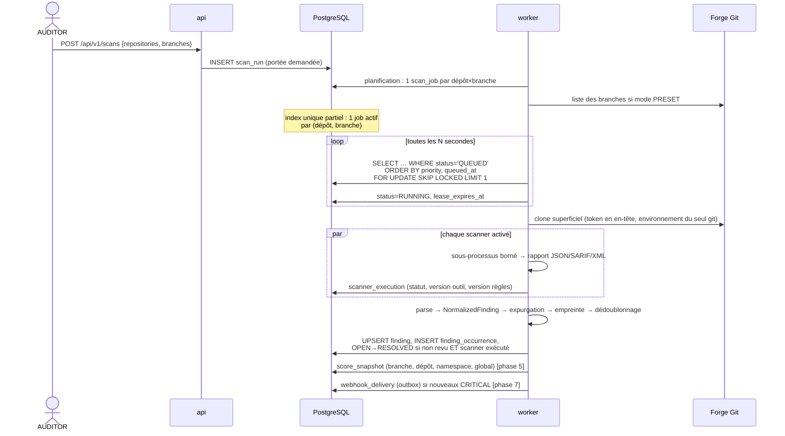

# SAYTU — Architecture (phase 1)

> Statut : architecture cible validée en phase 1. Les sections marquées **[phase N]** décrivent
> ce qui sera implémenté plus tard ; rien de ce qui est marqué ainsi n'existe encore dans le code.

## 1. Objectifs et contraintes structurantes

| Contrainte | Conséquence architecturale |
|---|---|
| 100 % on-premise, aucun SaaS | Aucune dépendance réseau sortante en fonctionnement normal ; bases de vulnérabilités importables hors ligne ; IA locale (Ollama) uniquement. |
| Aucun code/token vers l'extérieur | Scanners exécutés en mode *offline*, télémétrie coupée, analyseurs « en ligne » de Dependency-Check désactivés, egress filtrable. |
| Code non fiable analysé | Aucun script de build exécuté, clone sans hooks ni sous-modules, scanners en sous-processus bornés (temps, CPU, mémoire, disque), environnement vide. |
| Multi-organisations / multi-dépôts | Modèle `connexion → namespace → dépôt → branche`, file d'exécution persistante, scores agrégés à chaque niveau. |
| Score honnête | Un scanner non exécuté réduit la **couverture** ; il n'améliore jamais le score. Score masqué si la couverture est insuffisante. |
| Simplicité d'exploitation | Monolithe modulaire, PostgreSQL comme seul état (y compris la file), Docker Compose. |

## 2. Vue de déploiement



| Service | Image | Rôle | Exposé |
|---|---|---|---|
| `web` | `nginx-unprivileged` + build Angular | SPA, CSP stricte, reverse proxy `/api`, config runtime `/assets/config.json` | port `SAYTU_HTTP_PORT` |
| `api` | `eclipse-temurin:21-jre-alpine` | API REST, sécurité, découverte Git, planification, scoring, rapports | non (via `web`) |
| `worker` | `eclipse-temurin:21-jre-noble` + git + Opengrep / Trivy / Gitleaks (versions figées, SHA-256 vérifié) ; même application, `SAYTU_WORKER_ENABLED=true` | planifie les audits, consomme la file, clone, exécute les scanners, enregistre les résultats, met à jour la base Trivy | non |
| `keycloak` | `quay.io/keycloak/keycloak:26.4` | OIDC, rôles ADMIN/AUDITOR/VIEWER, MFA, anti-bruteforce | port `SAYTU_KEYCLOAK_PORT` |
| `postgres` | `postgres:16-alpine` | base `saytu` (rôle `saytu`) + base `keycloak` (rôle `keycloak`), isolées | non |
| `ollama` | `ollama/ollama` (profil `ai`) | LLM local pour les recommandations | non, réseau `data` sans egress |

Le réseau `data` est `internal: true` : PostgreSQL et Ollama n'ont aucune route vers l'extérieur.

## 3. Découpage logiciel (monorepo)

```
saytu/
├── backend/                 Maven multi-module (Java 21)
│   ├── saytu-core/            domaine + ports, AUCUNE dépendance framework
│   ├── saytu-git/             connecteurs Git, JDK seul (java.net.http) — ADR-0005
│   └── saytu-app/             Spring Boot : persistance, REST, sécurité, worker
├── frontend/                Angular 20 standalone, zoneless, signals
├── infra/                   realm Keycloak, init PostgreSQL
├── scripts/                 génération des secrets, vérification du schéma
├── docs/                    architecture, modèle de données, ADR, licences
└── docker-compose.yml
```

### 3.1 `saytu-core` — domaine et ports (hexagonal)

| Package | Contenu | État |
|---|---|---|
| `core.domain` | `Severity`, `FindingType`, `FindingStatus`, `ScanStatus`, `ScannerExecutionStatus`, `ScannerId`, `GitProviderType`, `NamespaceKind` | ✅ phase 1 |
| `core.finding` | `NormalizedFinding`, `FindingFingerprint` (identifiant stable), `FindingDeduplicator`, `SecretRedactor` | ✅ phase 1 |
| `core.git` | port `GitProvider` (+ `GitConnectionSpec`, pagination par curseur, `GitProviderException` typée) | ✅ interface |
| `core.scan` | port `ScannerAdapter`, `CommandSpec` (argv sans shell, env filtré), `ScanContext`, `ResourceLimits` | ✅ interface ; implémentations phases 4-5 |
| `core.remediation` | port `RemediationProvider` | ✅ interface ; implémentations phase 7 |
| `core.report` | `ReportFormat` | ✅ ; générateurs phase 6 |
| `core.security` | `SensitiveValue` (secret jamais imprimable), `TokenCipher` (AES-256-GCM, rotation de clé) | ✅ phases 1-2 |

### 3.1 bis `saytu-git` — connecteurs (phase 2)

| Package | Contenu | État |
|---|---|---|
| `git.http` | `GitHttpClient` (seule sortie réseau), `EndpointPolicy` (anti-SSRF), `HttpErrorClassifier`, `TrustConfig` (CA interne), `Auth` | ✅ |
| `git.json` | lecteur JSON strict et borné | ✅ |
| `git.provider` | GitLab, GitHub, Bitbucket Cloud, Bitbucket Data Center, local : **test de connexion** ✅ ; découverte (namespaces, dépôts, branches) **phase 3** | partiel |

`saytu-core` est compilable et testable avec le seul JDK : c'est là que se trouve la logique critique
(empreintes, dédoublonnage, expurgation, invariants de sécurité des commandes).

### 3.2 `saytu-app` — application Spring Boot

Organisation **par fonctionnalité** ; les dépendances entre packages sont acycliques (vérifié par
ArchUnit, `ArchitectureTest`).

| Package | Responsabilité | État |
|---|---|---|
| `app.config` | sécurité (resource server JWT), mapping des rôles Keycloak, OpenAPI, propriétés `saytu.*` | ✅ |
| `app.source` | entités/référentiels connexions, namespaces, dépôts, branches | ✅ persistance ; services phases 2-3 |
| `app.scanner` | configuration des scanners | ✅ lecture |
| `app.system` | `GET /api/v1/system/info` (version, scanners configurés, rôles de l'appelant) | ✅ |
| `app.web` | erreurs RFC 9457, sans trace ni SQL côté client | ✅ |
| `app.vault` | `TokenVault` : clé maître, chiffrement des tokens | ✅ phase 2 |
| `app.git` | câblage Spring d'`saytu-git` (`saytu.git.*`) | ✅ phase 2 |
| `app.audit` | journal `audit_event` des actions sensibles | ✅ phase 2 |
| `app.source` | + `GitConnectionService` / `GitConnectionController` (`/api/v1/git-connections`) | ✅ phase 2 |
| `app.scan` | runs, planification, file `SKIP LOCKED` + bail, worker, enregistrement des findings (JDBC, `ScanSql`), API `/scans` et `/findings` | ✅ phase 4 |
| module `saytu-scan` (JDK seul) | `ProcessSandbox`, `GitCheckout`, adaptateurs Opengrep / Trivy / Gitleaks, `ScanJobRunner` | ✅ phase 4 |
| `app.scanners.*` **[phases 4-5]** | adaptateurs `ScannerAdapter` | — |
| `app.scoring` **[phase 5]** | calcul et snapshots de scores | — |
| `app.report` **[phase 6]** | HTML, PDF, JSON, SARIF | — |
| `app.schedule`, `app.alert`, `app.remediation` **[phase 7]** | cron, webhooks, recommandations | — |

Un **même artefact** sert l'API et le worker (profils Spring `api` / `worker`) : une seule base de
code, un seul modèle, des déploiements séparables (le worker peut tourner sur une autre machine
puisqu'il ne parle qu'à PostgreSQL et aux forges Git).

## 4. Sécurité applicative

### 4.1 Authentification et autorisation

* SPA = client public Keycloak `saytu-web`, **authorization code + PKCE S256**, pas
  d'implicit flow ni de ROPC.
* API = resource server **stateless** : signature JWT (JWKS récupéré par le réseau interne),
  `iss` = URL publique de Keycloak, `aud` doit contenir `saytu-api` (mapper d'audience).
* Rôles = rôles de realm composites : `ADMIN ⊃ AUDITOR ⊃ VIEWER`. Seuls ces trois rôles sont
  convertis en autorités Spring ; les rôles techniques Keycloak sont ignorés.
* Politique **deny-by-default** : `/api/**` exige un rôle applicatif, tout le reste (hors
  `/actuator/health|info` et Swagger si `SAYTU_EXPOSE_API_DOCS=true`) est refusé. Les opérations
  d'écriture seront protégées par `@PreAuthorize` (phase 2).
* Realm : mot de passe ≥ 12 caractères, protection brute-force, TOTP imposé au premier
  administrateur, jetons d'accès de 5 min, rotation des refresh tokens.

| Action | VIEWER | AUDITOR | ADMIN |
|---|:-:|:-:|:-:|
| Consulter dashboards, findings, rapports | ✅ | ✅ | ✅ |
| Lancer un scan, trier un finding, générer un rapport | | ✅ | ✅ |
| Connexions Git, scanners, planifications, webhooks, paramètres | | | ✅ |

### 4.2 Secrets

| Secret | Stockage | Protection |
|---|---|---|
| Tokens Git, secrets webhook | `*_ciphertext BYTEA` | AES-256-GCM, IV aléatoire 96 bits, données associées = ligne propriétaire, `key_id` pour la rotation, clé maître `SAYTU_MASTER_KEY` hors base ✅ |
| Token en mémoire | `SensitiveValue` (`char[]`, `toString()` masqué, effaçable) | ✅ |
| URL de clone | jamais de credentials (contrainte `CHECK` en base + validation entité) | ✅ |
| Preuves de findings | `SecretRedactor` appliqué dans le constructeur de `NormalizedFinding` | ✅ |
| Logs | aucun en-tête/corps HTTP sortant journalisé ; erreurs client = identifiant de corrélation | ✅ |

### 4.3 Exécution des scanners — voir ADR-0003 (implémenté en phase 4)

Chaîne d'un job (`ScanJobRunner`) :

1. **Clone** (`GitCheckout`) : `git clone --depth 1 --single-branch --branch <b> --no-tags
   --no-recurse-submodules` avec `core.hooksPath=/dev/null`, `core.symlinks=false`,
   `protocol.allow=never` sauf `https` (et `file` pour les connexions LOCAL sous la racine
   configurée), `http.followRedirects=false`, LFS désactivé, aucune configuration globale ou
   système. Le token voyage dans un en-tête `Authorization` défini par les variables
   `GIT_CONFIG_*` de l'environnement du **seul** processus `git`, limité à l'origine du dépôt :
   jamais dans l'URL, la ligne de commande ou `.git/config`. Nom de branche validé comme
   `git check-ref-format` (pas d'option déguisée).
2. **Assainissement** : lecture du commit, suppression de `.git/`, suppression de tout lien
   symbolique restant, quota de taille et de nombre de fichiers.
3. **Analyse** : un sous-processus par scanner, construit à partir d'un `CommandSpec` :
   argv sans shell ; environnement **vide** + liste blanche (les noms de type `*TOKEN*`, `*SECRET*`,
   `*PASSWORD*`, `*ASKPASS*` sont refusés à la construction) ; répertoire de travail privé 0700 hors
   des sources ; `prlimit` (CPU, taille de fichier, descripteurs, pas de core dump) ; mémoire
   résidente de l'arbre de processus surveillée ; `timeout` avec destruction de l'arbre de
   processus ; options *offline* de chaque outil ; mécanismes de suppression du dépôt ignorés.
4. **Nettoyage** systématique (bloc `finally`) des sources et des rapports (qui peuvent contenir
   des secrets en clair : seuls une empreinte SHA-256 et un extrait masqué sont conservés).

Un scanner qui n'a pas terminé est enregistré `FAILED` ou `TIMED_OUT` avec la raison, jamais comme
« aucun résultat ». Trivy sans base de vulnérabilités analyse quand même les fichiers de configuration,
mais l'exécution est enregistrée `FAILED` (« dependencies were NOT checked »).

Aucun outil de build (`mvn`, `gradle`, `npm install`, `pip`…) n'est invoqué. Les scanners
d'artefacts (Trivy, Dependency-Check) lisent les manifestes et lockfiles tels qu'ils sont dans le
dépôt.

## 5. Flux principaux

### 5.1 Exécution d'un audit **[phases 4-5]**



Règles de cycle de vie des findings :

* nouvelle empreinte → `OPEN` ;
* empreinte absente d'un scan **dans lequel le scanner producteur a réussi** → `RESOLVED` ;
  si le scanner a échoué ou a été désactivé, le finding reste `OPEN` (pas de faux « corrigé ») ;
* `ACCEPTED_RISK` / `FALSE_POSITIVE` : décisions humaines avec motif et auteur obligatoires
  (contrainte SQL), jamais écrasées automatiquement, historisées dans `finding_status_history`.

### 5.2 File d'exécution et concurrence — ADR-0002

* La file est la table `scan_job` (PostgreSQL `SKIP LOCKED`) : transactionnelle, persistante,
  aucune brique supplémentaire (Kafka, RabbitMQ, Redis) à exploiter.
* Parallélisme borné par worker (`worker.concurrency.maxParallelJobs`) ; plusieurs workers
  possibles.
* **Bail** (`lease_expires_at`) renouvelé pendant l'exécution ; un job dont le bail expire
  (crash du worker) est remis en file jusqu'à `max_attempts`.
* Planification **[phase 7]** : expressions cron Spring, évaluées par une seule instance grâce à
  un *advisory lock* PostgreSQL ; option « ignorer si le commit n'a pas changé ».

### 5.3 Découverte Git **[phases 2-3]**

| Fournisseur | Namespaces | Pagination | Limites de débit |
|---|---|---|---|
| GitLab SaaS / Self-Managed (API v4) | groupes, sous-groupes, namespace utilisateur | `page`/`per_page` ou keyset | `429` + `Retry-After`, en-têtes `RateLimit-*` |
| GitHub Cloud / Enterprise Server (API v3) | organisations, compte utilisateur | en-tête `Link` | `403/429` + `x-ratelimit-remaining/reset`, `Retry-After` (limite secondaire) |
| Bitbucket Cloud (API 2.0) | workspaces | champ `next` | `429` |
| Bitbucket Data Center (API 1.0) | projets | `start`/`limit`/`isLastPage` | `429` selon configuration |
| Local | répertoires montés en lecture seule | — | — |

Le curseur opaque de `GitProvider.PageRequest` unifie ces quatre modes. Les erreurs sont typées
(`AUTHENTICATION_FAILED`, `INSUFFICIENT_PERMISSIONS`, `RATE_LIMITED` avec délai, `TLS_ERROR`…)
pour que l'UI affiche une action précise (« le token n'a pas le scope `read_api` »).

## 6. Normalisation et dédoublonnage (implémenté en phase 1 dans `saytu-core`)

Chaque adaptateur produit des `NormalizedFinding`. L'empreinte (SHA-256, 64 hex) est :

| Type | Matière de l'empreinte | Pourquoi |
|---|---|---|
| `DEPENDENCY` | écosystème + paquet + version installée + CVE (ou id de règle) | Trivy (lockfile) et Dependency-Check (jar) rapportent des chemins différents pour la même vulnérabilité |
| `SECRET` | chemin + hash du secret (jamais le secret) | stable si le fichier est édité ailleurs |
| `SECURITY` | type + **premier CWE** (sinon `scanner:règle`) + chemin + hash de la ligne normalisée | dédoublonne Opengrep / PMD sur la même faiblesse ; insensible au décalage de lignes et à l'indentation |
| `QUALITY` | type + `scanner:règle` + chemin + hash de ligne | pas de fusion inter-outils sur la qualité (règles non équivalentes) |

Fusion : sévérité la plus haute, union des CWE et références, première recommandation non vide ;
chaque rapport d'origine est conservé (`finding_occurrence`).

## 7. Scoring **[phase 5]** — proposition `v1`, configurable (`app_setting: scoring.formula`)

Pour une branche, avec les findings **OPEN** uniquement :

* poids de sévérité `w_sev` : CRITICAL 25, HIGH 10, MEDIUM 4, LOW 1, INFO 0 ;
* poids de nature `w_type` : SECRET 1,2 — SECURITY 1,0 — DEPENDENCY 0,8 (exploitabilité non
  prouvée) ; QUALITY alimente uniquement le score qualité ;
* pénalité `P = Σ w_sev × w_type` ; **score = 100 × e^(−P / K)** (K = 50 sécurité, K = 80
  qualité ; la pénalité qualité est rapportée à la taille du code en KLOC) ;
* plafonds : au moins un CRITICAL ouvert ⇒ score sécurité ≤ 40 ; un secret ouvert ⇒ ≤ 60 ;
* **global = 0,7 × sécurité + 0,3 × qualité**.

**Couverture** = Σ poids des scanners `SUCCEEDED` / Σ poids des scanners attendus pour la
catégorie (désactivés, échoués et expirés comptent au dénominateur ; `NOT_APPLICABLE` en est
exclu). Fiabilité : `HIGH` ≥ 90 %, `MEDIUM` ≥ 60 %, `LOW` ≥ 30 %, `INSUFFICIENT` < 30 % ⇒ score
non affiché (`NULL` en base), jamais 100.

Agrégation : dépôt = branche par défaut (les autres branches restent consultables) ;
namespace et global = moyenne des dépôts pondérée par la taille du code, accompagnée du pire
score et de la couverture minimale. Chaque `score_snapshot` mémorise `formula_version` et le
détail du calcul (`details` JSONB) pour être explicable et rejouable.

## 8. Flux réseau

| Source → Destination | Protocole | Quand | Désactivable |
|---|---|---|---|
| Navigateur → web / keycloak | HTTPS | toujours | — |
| api → keycloak (interne) | HTTP (réseau Docker) | rafraîchissement JWKS | — |
| api → forges Git | HTTPS | test de connexion, découverte | — |
| worker → forges Git | HTTPS | clone | — |
| worker → ollama (interne) | HTTP | recommandations IA | oui (par défaut) |
| api/worker → webhook configuré | HTTPS | alertes | oui |
| **Aucun** composant → services d'analyse tiers | — | jamais | — |

Les bases de vulnérabilités (Trivy DB, NVD pour Dependency-Check) et les jeux de règles sont
**importés** par l'exploitant (procédure hors ligne, phase 8) ; les scanners tournent en mode
`--offline` / `--skip-db-update` / `--noupdate`.

## 9. Choix technologiques

| Domaine | Choix | Version cible |
|---|---|---|
| Langage / runtime | Java (Temurin) | 21 LTS, threads virtuels activés |
| Framework | Spring Boot (Web MVC, Security 6, Data JPA, Actuator, Validation) | 3.5.x |
| Migrations | Flyway (PostgreSQL) | via BOM Spring Boot |
| API doc | springdoc-openapi | 2.8.x |
| Tests back | JUnit 5, Mockito, AssertJ, Testcontainers, ArchUnit | via BOM / 1.4.x |
| Front | Angular standalone + signals + zoneless, Karma/Jasmine | 20.3.x |
| IAM | Keycloak | 26.4 |
| Base | PostgreSQL | 16 |

## 10. Décisions (ADR)

* [ADR-0001](adr/0001-monolithe-modulaire.md) — Monolithe modulaire API + worker
* [ADR-0002](adr/0002-file-postgresql.md) — File d'exécution dans PostgreSQL
* [ADR-0003](adr/0003-isolation-scanners.md) — Isolation des scanners sans socket Docker
* [ADR-0004](adr/0004-chiffrement-tokens.md) — Chiffrement applicatif des tokens
* [ADR-0005](adr/0005-connecteurs-git-sans-dependance.md) — Connecteurs Git sans dépendance
* [ADR-0006](adr/0006-oidc-spa.md) — OIDC code + PKCE dans l'interface, sans bibliothèque

## 11. Limites connues de l'architecture

* L'isolation réseau **par processus** (interdire l'egress à un scanner tout en laissant le clone
  sortir) n'est pas garantie par Docker Compose seul : elle repose sur les options offline des
  outils, et l'exploitant peut ajouter un filtrage d'egress hôte (documenté en phase 8). Option
  renforcée prévue : bubblewrap (`--unshare-net`) si les user namespaces sont disponibles.
* Gitleaks analyse l'arbre courant (clone superficiel) : les secrets présents uniquement dans
  l'historique ne sont pas détectés dans le MVP (option « historique complet » envisagée).
* L'agrégation pondérée par KLOC suppose un comptage de lignes par le worker (phase 5).
