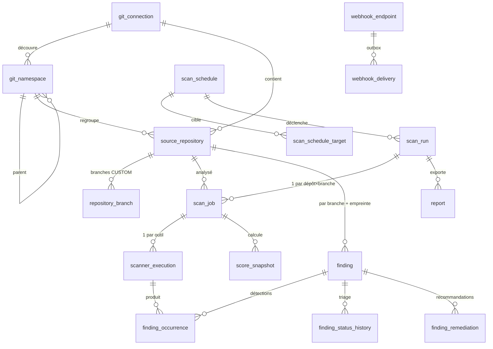

# Modèle de données

Source de vérité : `backend/saytu-app/src/main/resources/db/migration/V1__initial_schema.sql`
(vérifié sur PostgreSQL 16 par `scripts/verify-schema.sh`, 20 tables).

Conventions : clés UUID ; énumérations en `VARCHAR` + `CHECK` (portables, compatibles avec
`ddl-auto=validate`) ; horodatages `TIMESTAMPTZ` (UTC) ; secrets en `BYTEA` chiffré, toujours
accompagnés de l'identifiant de clé (`CHECK` d'appariement).

## Tables

| Table | Rôle | Points clés |
|---|---|---|
| `git_connection` | instance GitLab/GitHub/Bitbucket/local | `token_ciphertext` + `token_key_id` ; résultat du dernier test typé |
| `git_namespace` | organisation, groupe, sous-groupe, workspace, projet | `selected`, `include_all_repositories` (inclut les futurs dépôts) ; unique par `(connexion, external_id)` |
| `source_repository` | dépôt découvert | `CHECK` interdisant les credentials dans `clone_url` ; `branch_mode` DEFAULT / PRESET / CUSTOM |
| `repository_branch` | branches choisies + dernier commit analysé | permet « ignorer si inchangé » |
| `scanner_config` | activation et limites par outil | seed : 5 actifs, Dependency-Check inactif ; `settings` JSONB |
| `scan_schedule`, `scan_schedule_target` | planification cron | cible = tous les dépôts sélectionnés, des namespaces ou des dépôts |
| `scan_run` | une demande (manuelle, cron, API) | agrège les jobs |
| `scan_job` | unité de la file | index partiel de file ; **index unique partiel : 1 job actif par (dépôt, branche)** ; bail anti-crash |
| `scanner_execution` | résultat d'un outil sur un job | statut, version de l'outil **et des règles/base** (reproductibilité, couverture) |
| `finding` | problème distinct, suivi dans le temps | unique `(dépôt, branche, empreinte)` ; preuve expurgée ; triage avec motif obligatoire |
| `finding_occurrence` | chaque détection par chaque outil | conserve les rapports fusionnés ; sert au diff entre deux scans |
| `finding_status_history` | historique des décisions humaines | audit du triage |
| `finding_remediation` | recommandations (règles, Ollama) | une par fournisseur, `generative` affiché dans l'UI |
| `score_snapshot` | scores sécurité/qualité/global + couverture | `CHECK` de cohérence de portée ; score `NULL` si couverture insuffisante |
| `webhook_endpoint`, `webhook_delivery` | alertes | outbox transactionnelle, re-essais |
| `report` | exports HTML/PDF/JSON/SARIF | empreinte SHA-256 du fichier |
| `app_setting` | paramètres (formule de score, concurrence, Ollama) | JSONB |
| `audit_event` | journal des actions sensibles | **append-only** (trigger refusant UPDATE/DELETE) |

## Comparaison entre deux scans [phase 7]

Pour deux jobs A et B d'une même branche : nouveaux = empreintes présentes dans
`finding_occurrence` de B et absentes de A ; corrigés = l'inverse, **restreint aux scanners
`SUCCEEDED` dans les deux jobs** ; persistants = l'intersection.

## Rétention

Les `finding_occurrence`, `scanner_execution` et `score_snapshot` grossissent avec chaque scan.
Une purge configurable (par défaut : 13 mois d'historique détaillé, snapshots conservés) sera
ajoutée en phase 8.
